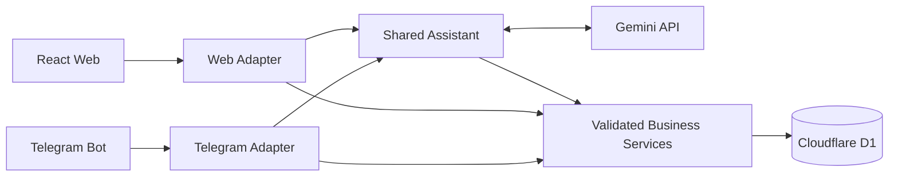

# Expenso

**Snap. Chat. Submit.**

An AI-powered expense assistant for reporting business expenses through Web and Telegram. Capture a receipt, correct details in natural language, check company policy and submit only when you are ready.

Built for the Navan Full Stack Engineer home assignment.

**[Live Web App](https://expenso.expenso-worker.workers.dev) · [Telegram Bot](https://t.me/GetExpensoBot) · [Technical Documentation](docs/TECHNICAL.md)**

No registration required. All expense data and company policies are fictional. Please do not upload real receipts or confidential information.

## Try it in two minutes

1. Open the [Telegram bot](https://t.me/GetExpensoBot), send `/start`, then upload a [sample receipt](worker/samples/receipt-cafe-aurora.png).
2. Press **Continue on web** and confirm the connection. Your conversation, draft and ledger are already there.
3. Type `Actually, make it $82 including the tip.` The slip updates and shows that the expense exceeds the $75 Meals limit by $7.
4. Press **Confirm and submit**. The expense appears in the ledger and Telegram receives a confirmation.

For a web-only experience, open the [web app](https://expenso.expenso-worker.workers.dev) and select **Try the sample**. To test failure handling, send a photo that is not a receipt or press an outdated confirmation button.

On desktop, send `/web` in Telegram and enter the pairing code under **Telegram** in the web app. Use `/signout` in Telegram to revoke all linked browser sessions.

## Key capabilities

- **Receipt intelligence:** extract merchant, amount, currency, date and description from an image; ask for missing or ambiguous details.
- **Contextual conversation:** correct an existing expense, ask policy questions and retrieve spending summaries.
- **Policy validation:** deterministic category limits and explicit manual-review status for over-limit expenses.
- **Cross-channel continuity:** start on Telegram, finish on the web and receive an update in Telegram.
- **User control:** preview, edit, confirm or discard a draft. No automatic submission.
- **Responsive experience:** web and mobile layouts, native Telegram buttons, progress and actionable error states.

## Architecture



One Cloudflare Worker serves the React app, API and Telegram webhook. Channel adapters are separate from the shared assistant and expense services. Both channels use the same database-backed state.

The model interprets requests and calls validated tools; application code enforces policy, money rules, ownership and state transitions. Confirmation bypasses the model entirely.

| Layer | Technology |
|---|---|
| Frontend | React, TypeScript, Vite, Tailwind CSS |
| Backend | TypeScript, Hono, Cloudflare Workers |
| Database | Cloudflare D1 (SQLite) |
| AI | Gemini 3.5 Flash Lite — tool calling and image input |
| Testing | Vitest, local Workers runtime |

## Design decisions

- **One conversation, two channels:** a linked browser opens the existing Telegram account rather than copying or merging data. Short-lived, single-use links or pairing codes require explicit confirmation.
- **Deterministic financial logic:** integer cents, server-side validation and policy rechecks. Submission is not approval or reimbursement.
- **Safe actions:** one active draft per account, atomic confirmation, duplicate-event protection and stale-button rejection.
- **Isolation and privacy:** account-scoped queries, hashed session tokens, secure cookies, verified Telegram webhooks and no stored receipt images.
- **Reliability:** bounded model requests, retries, timeouts, clear errors and per-user/application-wide usage caps.
- **Product UX:** a persistent expense slip and ledger separate proposed actions from completed ones.

## Run locally

Requires Node.js 22.12+ and npm.

```bash
npm install
npm run db:migrate:local
cp .env.example worker/.dev.vars
```

Set `GEMINI_API_KEY` in the ignored `worker/.dev.vars` file for live AI requests. Never commit credentials.

Start the API and frontend in separate terminals:

```bash
npm run dev:worker
npm run dev:web
```

Open http://localhost:5173.

For Telegram configuration, deployment, API routes, quotas and implementation details, see [Technical Documentation](docs/TECHNICAL.md). Use a separate Telegram bot for local experiments to avoid interrupting the live demo.

## Project structure

```text
web/                  React UI, views, components and state
worker/src/adapters/  Web and Telegram integrations
worker/src/assistant/ Shared AI assistant and receipt handling
worker/src/llm/       LLM interface and Gemini client
worker/src/services/  Business rules, sessions and persistence
worker/migrations/   D1 schema
shared/              Shared API contracts
docs/                Technical documentation
```

## Testing

```bash
npm run typecheck
npm test
npm run build
```

At the last application verification, **608 automated tests passed** (584 backend, 24 frontend), alongside type checking and build. Coverage includes conversation isolation, policy rules, explicit confirmation, receipt validation, failure handling, duplicate events and account handoff.

The deployed web app, mobile receipt capture, Telegram and cross-channel journey were also manually tested. Automated checks do not require live API credentials.

## Known limitations

- Demo policies are fixed, expenses are USD-only and dates use UTC.
- Receipt extraction depends on the model; uncertain fields require clarification.
- Free-tier AI quotas and provider availability can cause temporary delays or errors. Confirmation and discard remain available without the model.
- No enterprise authentication, approval or reimbursement integrations.
- Linked web sessions refresh on focus and periodically rather than via real-time push.

The deployed demo uses free-tier Cloudflare, Gemini and Telegram services. See the [technical reference](docs/TECHNICAL.md) for quota details, additional limitations and deployment instructions.

## With more time

I would prioritize configurable company policies, multi-currency support and enterprise authentication, then add approval workflows and expense-system integrations. For larger-scale deployment, I would strengthen abuse protection, session cleanup, observability and automated browser testing.
